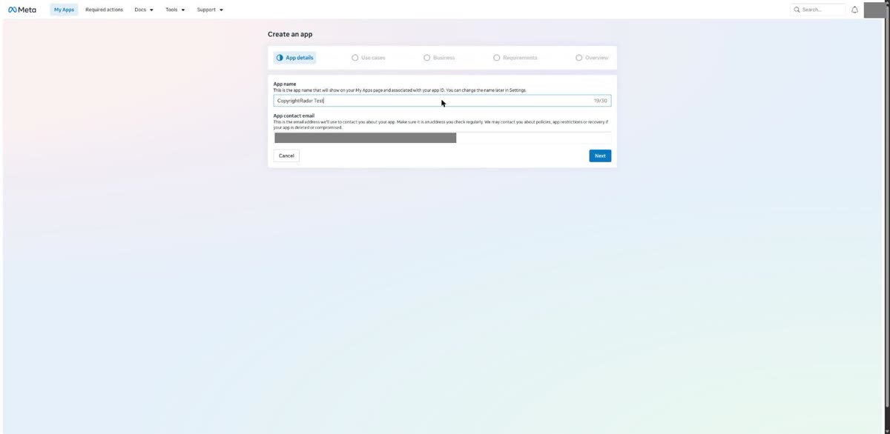
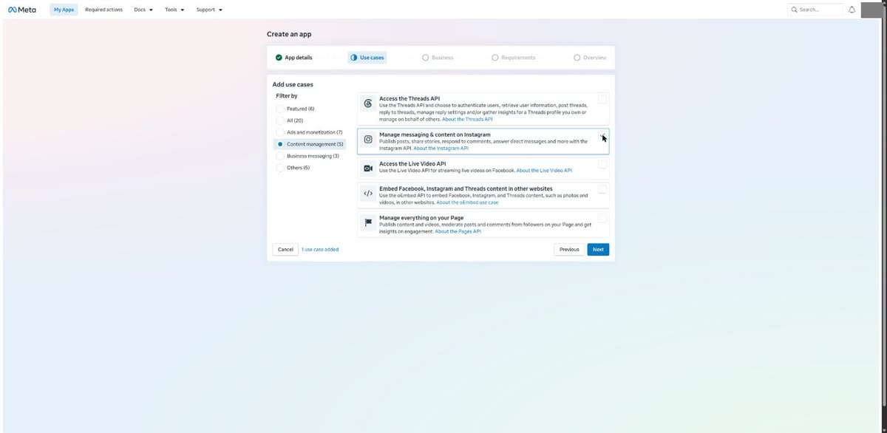
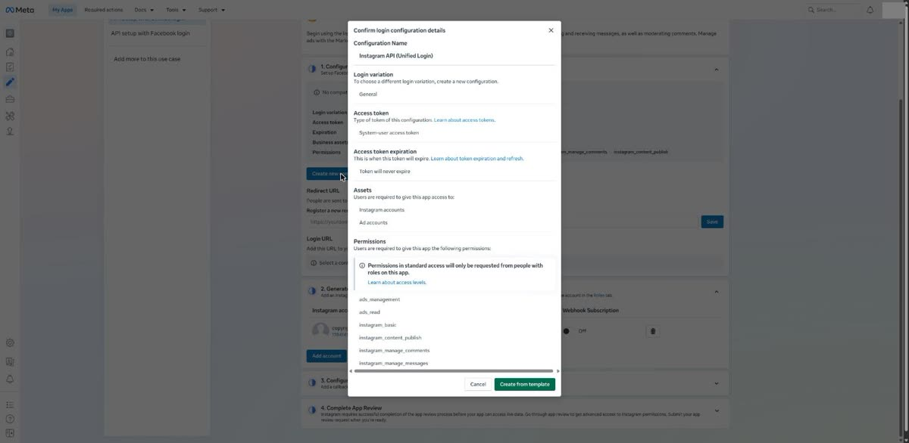
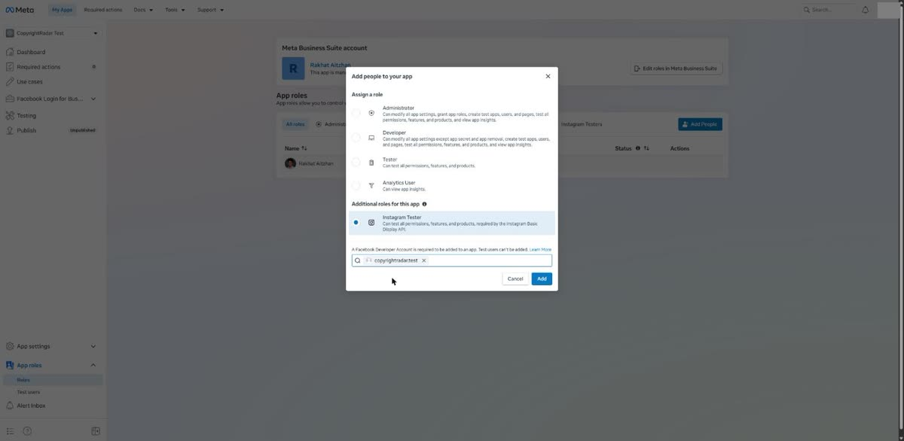
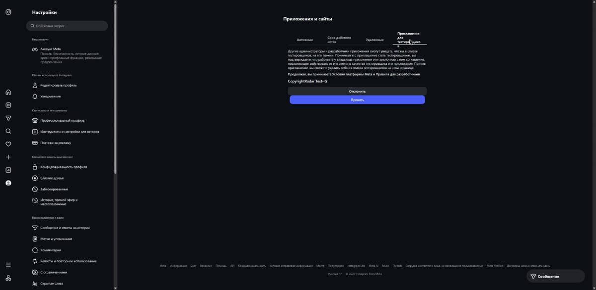
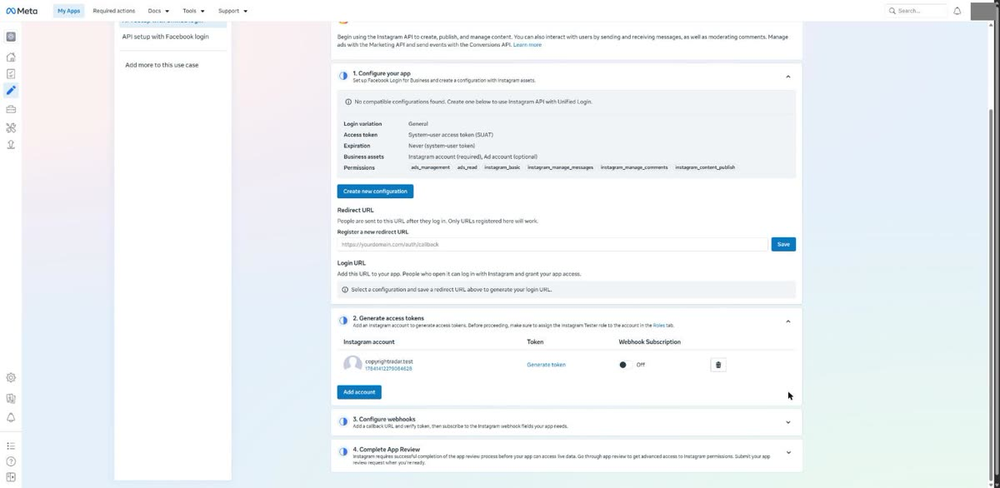
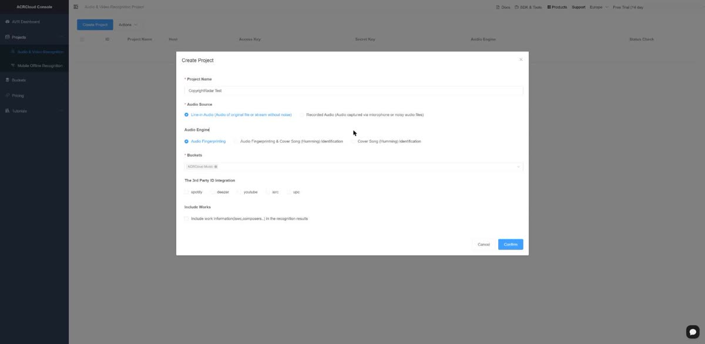
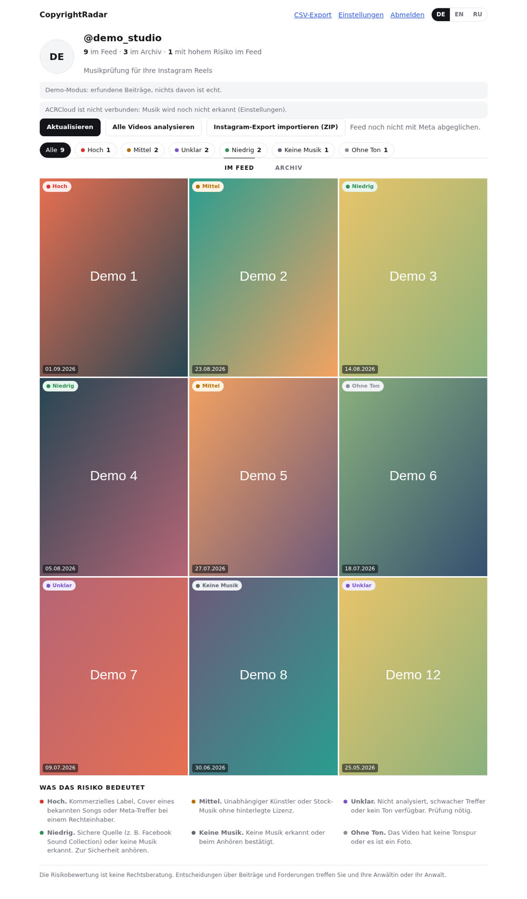
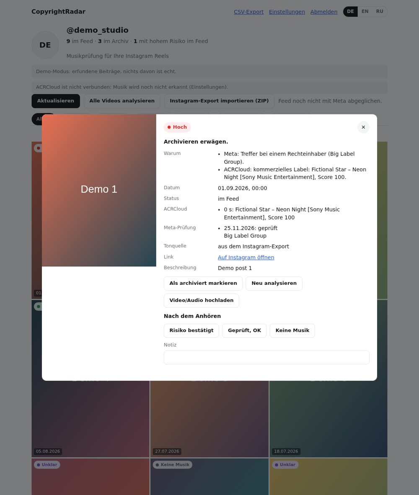
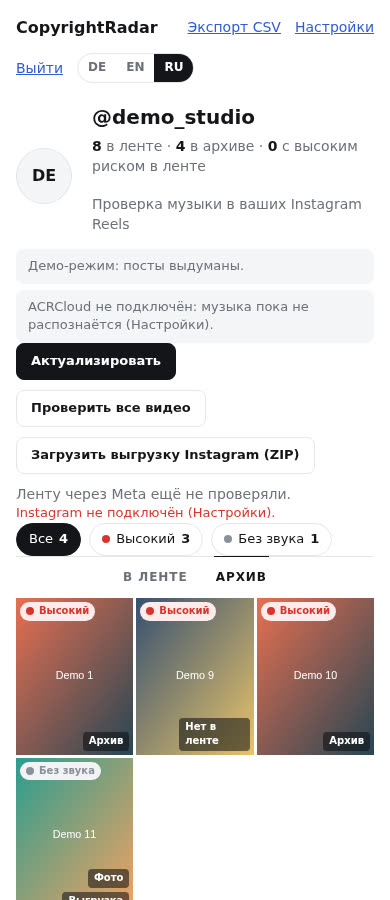

# Setup guide (step by step, with screenshots)

This guide was recorded on 27.11.2026 with a fresh test account. Meta changes its dashboard often; if a button looks different, look for the same words.

You need, about 30 minutes in total:

- an **Instagram professional account** (Creator or Business);
- a **Facebook account** (Meta for Developers only lets you in with Facebook);
- a **free business portfolio** in Meta Business Suite (Meta requires it for Instagram apps; a personal one is enough);
- an **ACRCloud account** (free trial: 14 days, 1 000 requests).

> Not legal advice. CopyrightRadar shows risk indicators. Decisions about posts and claims are yours and your lawyer's.

## 1. Start CopyrightRadar

```bash
git clone https://github.com/rahatow/CopyrightRadar copyright-radar && cd copyright-radar
docker compose up -d --build
```

Open http://127.0.0.1:8000 and set a password (at least 10 characters).

Running it on a server: the container listens on 127.0.0.1 only. Open it through an SSH tunnel (`ssh -N -L 8000:127.0.0.1:8000 your-server`) or a reverse proxy with HTTPS.

## 2. Instagram: professional account

In the Instagram app or on instagram.com: **Settings → Account type and tools → Switch to professional account → Creator** (or Business). Creator gives you the full music library.

## 3. Meta app

1. Open https://developers.facebook.com/apps and click **Create App**. Enter a name.

   

2. Use case: filter **Content management** and tick **Manage messaging & content on Instagram**.

   

3. Business portfolio: choose "I don't want to connect a business portfolio yet", then **Create app**.

4. In the app: **Use cases → Customize → API setup with Unified login**. Meta asks for a business portfolio here: connect your own (Meta Business Suite creates one for free).

   Since 2026 new apps no longer get "API setup with Instagram login"; Meta shows "Unified login" instead. CopyrightRadar supports both.

5. Step 1 on that page: **Create new configuration → Create from template**. Meta's template asks for more permissions than CopyrightRadar needs; the service only reads (GET requests). While the app stays in development mode, only people with roles in the app can grant them.

   

6. **App roles → Roles → Add People → Instagram Tester**, type your Instagram username, **Add**.

   

7. Accept the invite in Instagram: **Settings → Apps and websites → Tester invites → Accept** (on the web: instagram.com/accounts/manage_access/).

   

8. Back on **API setup with Unified login**, step 2: your account is listed. Copy the **Instagram account ID** under the username and click **Generate token**. Meta opens a separate window: log in as your Instagram account, allow access, copy the token.

   

9. In CopyrightRadar: **Settings → step 2**: paste the token and the Instagram account ID, click **Save and check**. The page shows `@your_account` and whether Meta returns its copyright check for your account.

Never paste the token anywhere else (chat, e-mail, files). CopyrightRadar stores it encrypted.

## 4. ACRCloud

1. Create an account at https://console.acrcloud.com and choose the region **Europe**.
2. **Audio & Video Recognition → Projects → Create Project**:
   - Project name: any;
   - Audio source: **Line-in Audio**;
   - Audio engine: **Audio Fingerprinting**;
   - Buckets: **ACRCloud Music**;
   - 3rd party IDs: tick **isrc**.

   

3. Copy **Host, Access Key, Secret Key** from the project row into CopyrightRadar **Settings → step 3**. The service checks the key with a few seconds of silence.

Recognition sends up to three 15-second audio fragments per video to ACRCloud. Add ACRCloud to your records of processing (DSGVO / GDPR) and check its data processing terms.

## 5. First check

1. Main page → **Refresh**. CopyrightRadar reads your posts and Meta's copyright check, downloads the videos Meta allows, and makes previews.
2. **Analyse all videos** sends the audio to ACRCloud.
3. Optional, recommended: **Import Instagram export (ZIP)**. In Instagram: Settings → Your activity → Download your information → format **JSON**. Meta does not let apps download videos with copyrighted music; the export is the only way to analyse exactly those.



Open a post to see why it got its risk level, the recognised track, Meta's status and the audio source. After listening, set your review (risk confirmed / OK / no music).



It also works on a phone:



## What the test run showed (27.11.2026)

| Test Reel | Expected | Result |
|---|---|---|
| video without audio track | No sound | No sound |
| own synthesised melody | Low, "not recognised – listen" | Low, "not recognised – listen" |
| new Reels, Meta's own check | — | Meta returned status `error` (not checked yet) |

- The Unified-login token works through `graph.facebook.com`, and Meta returns `copyright_check_information` there.
- Videos without copyrighted music can be downloaded through the API (`media_url`).
